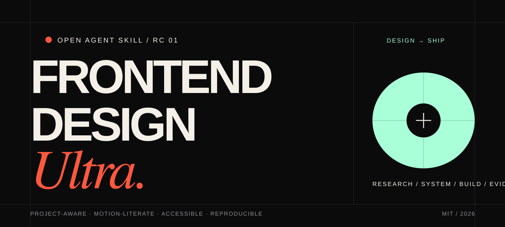
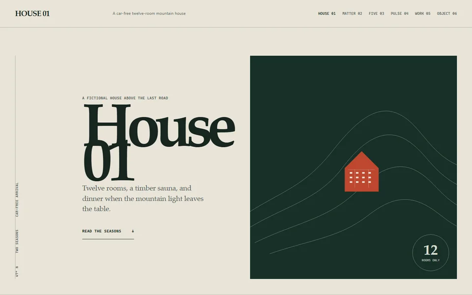
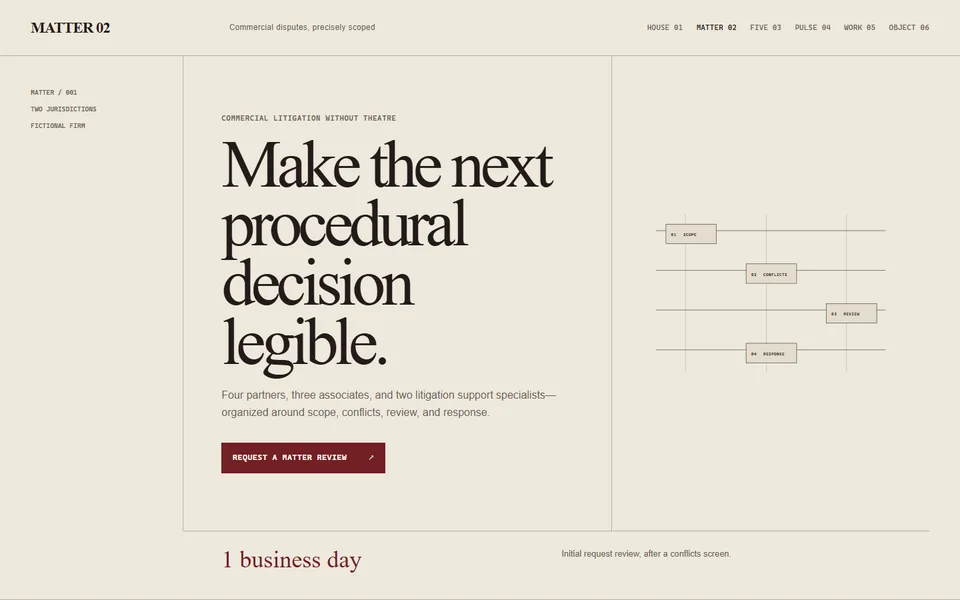
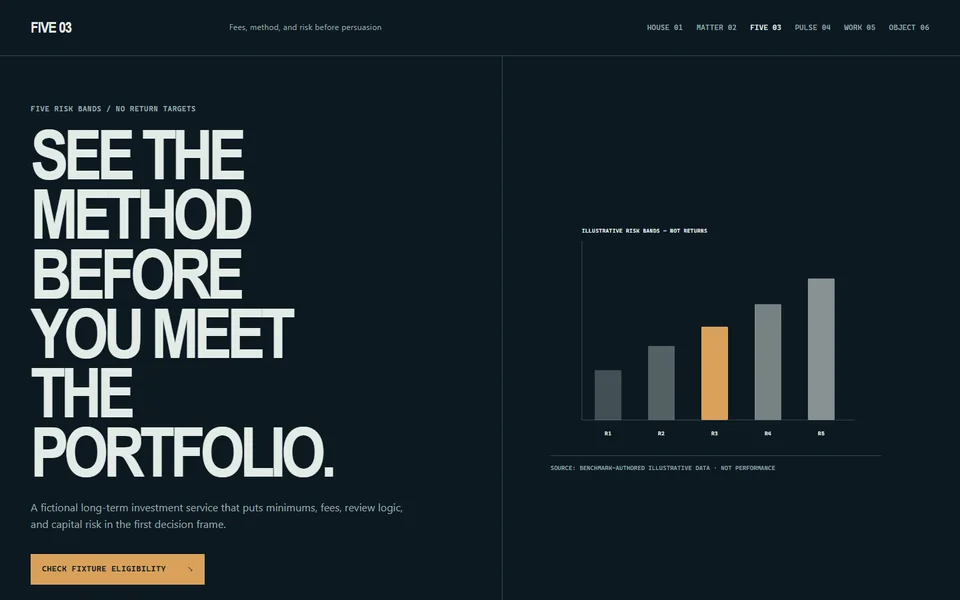
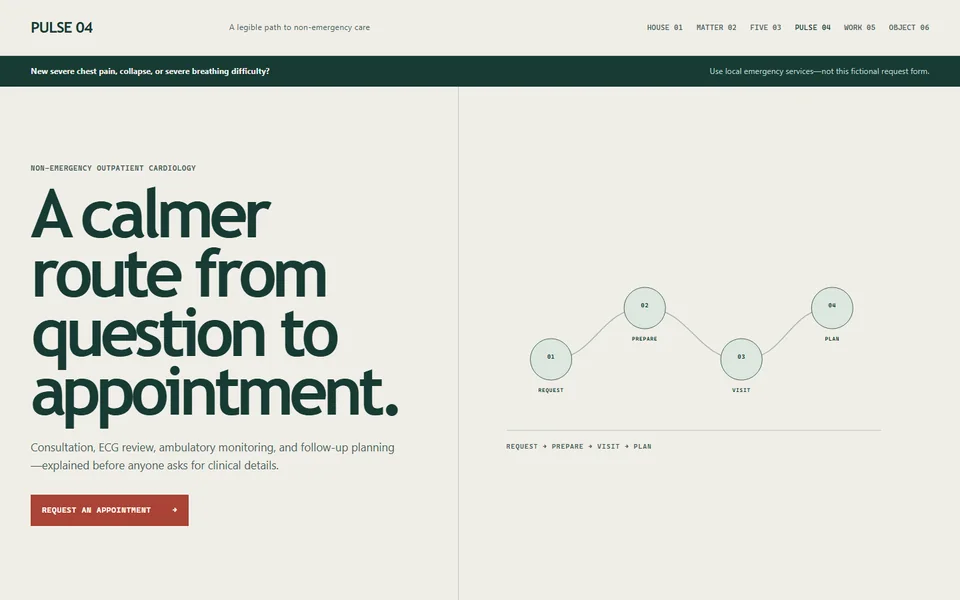
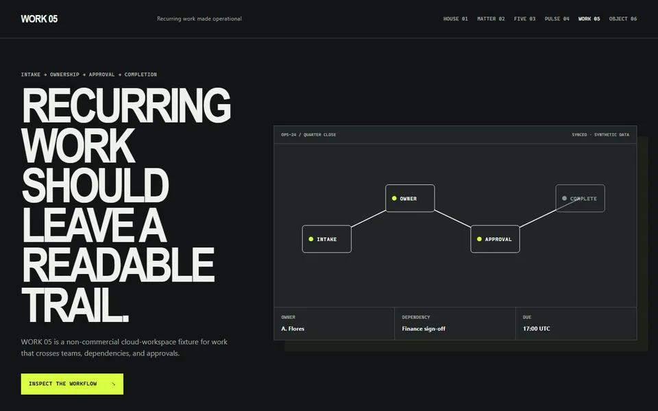
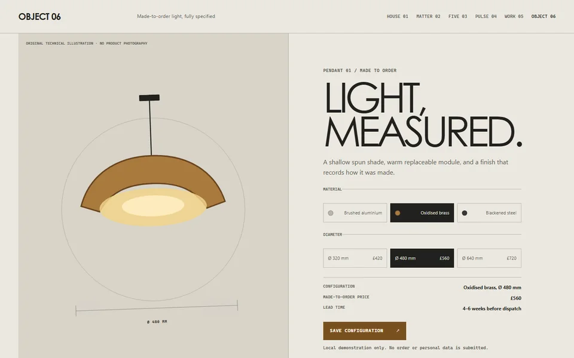
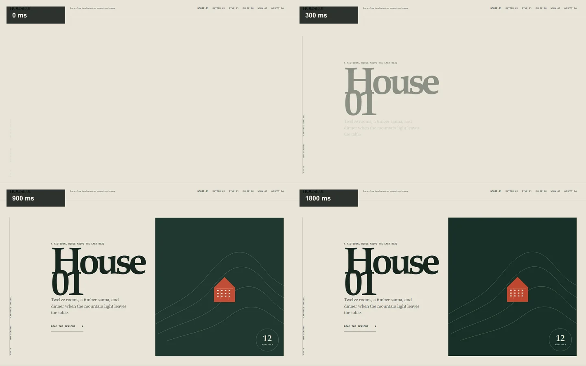

# Frontend Design Ultra

[](https://github.com/ov3rf1w/frontend-design-ultra/actions/workflows/validate.yml)
[](https://github.com/ov3rf1w/frontend-design-ultra/actions/workflows/showcase.yml)
[](https://github.com/ov3rf1w/frontend-design-ultra/actions/workflows/benchmark-validate.yml)




**A project-aware design operating system for AI coding agents that turns research, art direction, implementation, and browser evidence into one premium frontend workflow.**

Frontend Design Ultra helps AI agents design, critique, polish, implement, and verify professional web interfaces without falling into generic AI UI patterns. It is built for teams and solo builders who want fast frontend execution with senior-level design judgment: grounded when the project needs trust, expressive when the brief calls for editorial impact, and strict when accessibility, performance, or responsive behavior would otherwise be compromised.

It is an installable OpenAI Codex skill. The repository also ships manual adapters for other agents; those surfaces share the guidance, but are not claimed to be behaviorally identical until their eval matrix says so.

```text
Research -> Design System -> Strategy Lane -> Signature Move -> UI Spec -> Implementation -> Evidence QA
```

## Table of Contents

- [Why this exists](#why-this-exists)
- [Evidence status](#evidence-status)
- [What makes it different](#what-makes-it-different)
- [Reference and motion intelligence](#reference-and-motion-intelligence)
- [Original multi-industry showcase](#original-multi-industry-showcase)
- [Project-aware agency workflow](#project-aware-agency-workflow)
- [Install](#install)
- [Quickstart prompts](#quickstart-prompts)
- [Parameter system](#parameter-system)
- [Core workflows](#core-workflows)
- [Design operating model](#design-operating-model)
- [Quality gates](#quality-gates)
- [Agent support](#agent-support)
- [Repository structure](#repository-structure)
- [Evals and release checks](#evals-and-release-checks)
- [Competitive benchmark](#competitive-benchmark)
- [Documentation](#documentation)
- [Contributing](#contributing)

## Evidence status

This repository separates implemented infrastructure from visual-effect claims. The release candidate currently contains:

| Surface | Public, reproducible state |
|---|---|
| Skill | Installable dispatcher, progressive references, project inspector, deterministic validator, and regression tests |
| Reference intelligence | 76 dated multi-industry candidates across ten design lanes. The 20 newest-v2 scan outcomes are 11 complete, 7 partial, 2 unsupported, and 0 failed; 7 qualify as strict public observations and 13 remain diagnostic-only |
| Motion intelligence | 19 structured contracts: 16 evidence-pending recipes and 3 candidates, each with mobile, reduced-motion, runtime, failure, and rights rules. A recipe is not a code or build claim; verified and promoted patterns require complete original-build evidence. |
| Playwright evidence | Capture Contract v2 for commit-anchored entrance timing, verified scroll positions, real mobile emulation, reduced motion, video, opt-in traces, Web Animations/computed-state coverage, and runtime failures. The 20-site run produced 1,990 raw files / 2.227 GiB that remain private and are excluded from releases |
| Original showcase | 6 repository-authored fictional industry builds with a static export, compact public renders, and local desktop/mobile/motion/interaction evidence; no third-party visual assets are declared, but this is not a legal-clearance claim or a benchmark result |
| Public media | 9 SVG/WebP assets enumerated in one schema-validated provenance manifest with exact SHA-256, origin, license, redistribution status, review date, and claim boundary |
| Blind benchmark | Versioned draft protocol, 4 conditions, 6 calibration briefs, and a 72-slot planned calibration matrix; **0 scored runs and 0 jury votes so far** |
| Leadership claim | None. A claim is blocked until blinded results, failed runs, shipping evidence, and limitations are published |

Structural checks prove packaging and contract integrity. They do not prove that the skill produces better-looking websites. The benchmark is designed to test that separately.

## Why this exists

AI-generated frontend work often fails for predictable reasons:

- it starts styling before strategy
- it uses default typography and generic color palettes
- it repeats card grids, purple glows, vague SaaS sections, and fake proof
- it designs desktop first and squeezes mobile later
- it treats motion as decoration instead of information architecture
- it ships without component states, accessibility, performance, or browser evidence

Frontend Design Ultra gives agents a stricter operating system. It forces research, design-system decisions, page-specific strategy, responsive viewport planning, asset realism, motion restraint, implementation discipline, and verification before claiming a UI is done.

## What makes it different

### Research-first

For substantial work, the skill asks the agent to extract real mechanics before making design decisions:

- domain expectations
- audience intent
- trust friction
- proof needs
- reference mechanics
- overused patterns to avoid
- accessibility and performance constraints
- evidence confidence

### Design-system-first

If no brand system exists, the agent must generate one before designing:

- typography package
- color and surface system
- grid and spacing rhythm
- radius and elevation language
- component primitives and states
- motion scale
- responsive viewport strategy
- asset language
- accessibility and performance gates

### Built for analysis and polish, not only generation

The skill treats `/analyse`, `/polish`, and `/verify` as first-class workflows. It is designed to diagnose why a UI feels generic, cheap, confusing, fragile, or untrusted, then produce concrete moves to fix it.

### Evidence-led when possible

For URL or local-app work, the skill prefers browser evidence over opinion when the user, host, and project policy authorize capture:

- desktop screenshots
- mobile screenshots
- compact laptop and wide monitor checks
- console/runtime issues
- layout overflow
- interaction smoke tests
- accessibility smoke checks
- performance risks
- reduced-motion behavior

### Project-aware, not starter-bound

The skill inspects the real project before substantial implementation and separates four evidence levels: installed, configured, declared in prose, and inferred. It can therefore work with an existing product, a framework scaffold, or a documentation-only starter without pretending they have the same capabilities.

```bash
node frontend-design-ultra/scripts/inspect-project.mjs /path/to/project
```

The output is a Project Fit Brief covering the stack, runnable commands, project contracts, risks, and next actions.

Fit labels are scoped, not quality certificates: `bridge-ready` means a starter handshake is valid, `baseline-ready` means a runnable baseline exists without a validated stack profile, and `profile-ready` means the profile's machine-checkable floor passed. Manual architecture, responsive, reduced-motion, accessibility, visual, and shipping evidence still remain.

Independently versioned starters can add `.frontend-design-ultra/project-fit.json` and validate it against the shipped schema. The handshake maps project artifacts and expectations, but never overrides the real manifest, filesystem, user instructions, or screenshot policy.

## Reference and motion intelligence

The public corpus stores source links and derived design hypotheses, not copied pages. Query it by industry, design lane, scan priority, asset dependency, or scan risk:

```bash
npm run reference:query -- references --priority must-scan --lane editorial-engine
```

The motion catalog is retrieval-oriented rather than a gallery of fashionable effects. Query by information job, trigger, target domain, asset cost, or evidence status:

```bash
npm run reference:query -- motion --effect-job causality --trigger scroll
```

For an authorized public page, the Playwright scanner captures the temporal states that a single screenshot loses:

```bash
npm run reference:scan -- \
  --url https://example.com \
  --id example \
  --rights-basis public-page-private-research-no-republication \
  --rights-reviewed-at 2026-07-16 \
  --reviewer-id project-owner
```

The newest-v2 batch visited all 20 designated references: 11 completed, 7 were partial, 2 were unsupported, and none failed. Seven complete captures passed the stricter artifact-integrity and reduced-motion publication gate; the other 13 are diagnostic-only. These are machine capture and eligibility states, not human aesthetic approvals. The 1,990 raw files / 2.227 GiB remain private and are not packaged.

The default run records seven navigation-commit-anchored entrance frames from fresh, isolated browser contexts with measured timing drift, ten target-versus-actual scroll states, desktop and real touch/mobile contexts, isolated hover/click probes, settled full pages, reduced motion, explicit-dimension continuous videos, animation/computed-state signals, and runtime failures. Diagnostic traces are opt-in. A blocked public analytics or tracking subresource is retained as a network-policy warning; it invalidates a capture only when the affected capture step itself fails. Raw captures default to the private OS-local cache selected by `FDU_EVIDENCE_ROOT` or the platform cache convention. Repository-local and known cloud-synchronized output paths are rejected. The public repository may promote only reviewed mechanics and original reconstructions unless redistribution rights for source media are documented.

See [Reference Intelligence](frontend-design-ultra/references/reference-intelligence.md), [Motion Pattern Catalog](frontend-design-ultra/references/motion-pattern-catalog.md), and the [benchmark subsystem](benchmark/README.md).

## Original multi-industry showcase

One design system should enforce quality without forcing every client into one aesthetic. The repository therefore includes six executable, fictional builds using the current Next.js, React, Tailwind CSS, TypeScript, and GSAP stack. They share production discipline, but differ in typography, composition, proof, interaction, motion, palette, and mobile order.

| Hospitality · typographic alpine field guide | Legal · procedural case-file grid |
|---|---|
|  |  |
| Finance · restrained data/proof atlas | Healthcare · human care-path editorial |
|  |  |
| SaaS · operational interface stage | E-commerce · material object showroom |
|  |  |

The entrance storyboard below preserves four temporal states of the editorial hospitality direction in reading order: 0, 300, 900, and 1800 milliseconds.



These are curated original examples, not preference data. The raw Playwright time series and scroll slices remain local; the public renders are covered by a [browser evidence note](showcase/EVIDENCE.md), a [SHA-256 capture manifest](docs/assets/showcase/manifest.json), the [repo-wide media provenance manifest](docs/assets/media-provenance.json), and the [showcase provenance ledger](showcase/PROVENANCE.md).

The evidence path is executable rather than editorial-only:

```bash
cd showcase && npm run build && cd ..
npm run showcase:audit
npm run showcase:capture-gallery
```

The audit covers all six routes in desktop, real touch/mobile, reduced-motion,
no-JavaScript, and local-interaction profiles. Gallery publication is blocked
unless that private audit report has zero issues.

## Project-aware agency workflow

Keep four layers connected but independently versioned:

- the skill owns strategy, art direction, UI/UX judgment, implementation governance, and verification;
- the starter owns framework code, dependencies, configs, scripts, and reusable mechanics;
- the client project owns brand, content, assets, routes, tokens, decisions, and evidence;
- an optional private agency overlay owns confidential provenance and a local recent-build fingerprint ledger.

This avoids a monolith: the skill stays portable while a Next.js/Tailwind/GSAP starter can evolve on its own release cadence. New client sites compare three subject-grounded directions, select one, record why the other two were rejected, and then implement against an explicit design contract.

## Install

### Open Agent Skills CLI

```bash
npx skills add ov3rf1w/frontend-design-ultra --skill frontend-design-ultra -g -a codex
```

This is the simplest install surface. For a trust-pinned install, use a versioned release artifact after the first public release or inspect an exact commit locally as shown below.

### Auditable local checkout

```bash
git clone https://github.com/ov3rf1w/frontend-design-ultra.git
cd frontend-design-ultra
git checkout --detach <40-character-commit>
npm ci --ignore-scripts
npm run build
bash install.sh --local
```

Windows local checkout:

```powershell
git clone https://github.com/ov3rf1w/frontend-design-ultra.git
cd frontend-design-ultra
git checkout --detach <40-character-commit>
npm ci --ignore-scripts
npm run build
.\install.ps1 -Source Local
```

Do not pipe a mutable `main`-branch installer directly into a shell. The release packager produces a deterministic installable archive, `release-manifest.json`, and `SHA256SUMS`; those become the recommended pinned surface when the first GitHub release is published. Until then, this repository is an RC and the exact-commit checkout is the auditable path.

After installation, restart Codex so the skill metadata reloads.

### Optional scanner runtime

Normal design, audit, implementation, and verification use does not require an npm install inside the skill. Only the live-reference scanner needs its locked runtime. After installing through Agent Skills CLI, a release archive, or either repository installer, run this once in the installed `frontend-design-ultra` directory:

```bash
npm ci --ignore-scripts
```

Exploratory scans use `--browser auto` by default and can reuse an existing Chrome or Edge installation, so no browser download is required. Reproducible `--evidence-tier benchmark` scans require the Chromium build paired with the pinned `playwright-core` 1.61.1 runtime:

```bash
npm run browser:install
```

That command is the locked-package equivalent of `npx playwright-core install chromium`. The skill installers never run either command or download a browser automatically.

More setup detail:

- [Installation](docs/INSTALLATION.md)
- [Install Surface](docs/INSTALL-SURFACE.md)
- [Release And GitHub Hardening](docs/RELEASE.md)
- [Reference And Provenance Policy](docs/REFERENCE_POLICY.md)
- [Platforms](docs/platforms.md)

## Quickstart prompts

### Create a premium landing direction

```text
/design /landing /premium /research /brandkit /deep
Create a homepage direction for a boutique AI analytics product. No brand guidelines exist yet.
```

Expected behavior:

- research read
- generated design system
- typography and color direction
- strategy lane
- signature move
- responsive viewport plan
- implementation notes
- verification plan

### Make an existing UI less generic

```text
/polish /landing /awwward /brutal
This hero feels like AI slop. Diagnose it and give me the highest-impact fixes.
```

Expected behavior:

- visual diagnosis
- root cause
- keep/delete/replace/rebuild
- typography, spacing, hierarchy, surface, and motion fixes
- gate risks

### Audit a live URL

```text
/analyse https://example.com /playwright /performance /accessibility /mobile /brutal
```

Expected behavior:

- evidence-first findings
- severity and impact
- console/runtime issues
- responsive and mobile risks
- accessibility and performance follow-up

### Verify readiness to ship

```text
/verify /playwright /mobile /performance /accessibility
Can this page ship?
```

Expected behavior:

- Pass / Fail / Needs Review
- browser evidence
- viewport results
- console/runtime issues
- accessibility smoke
- performance risks
- ship recommendation

### Design an editorial motion system

```text
/design /editorial /awwward /motion-high /gsap /deep
Create a scroll-driven editorial landing direction with one signature motion move and reduced-motion fallback.
```

Expected behavior:

- motion intent
- GSAP / Framer / CSS decision
- choreography layers
- mobile alternative
- reduced-motion fallback
- performance risks

## Parameter system

Frontend Design Ultra uses slash parameters as a structured grammar. Agents can infer them from natural language, but explicit parameters give the best routing.

### Modes

| Parameter | Purpose |
|---|---|
| `/analyse` | Audit existing UI and produce evidence-backed findings. |
| `/design` | Create strategy, direction, design system, and UI spec before implementation. |
| `/polish` | Improve an existing interface through diagnosis and high-impact design moves. |
| `/implement` | Perform authorized code changes, run relevant checks, and report remaining evidence gaps. |
| `/verify` | Decide Pass, Fail, or Needs Review from evidence and hard gates. |

Mode precedence:

```text
/verify > /implement > /polish > /design > /analyse
```

### Domains

| Group | Parameters |
|---|---|
| Page and product | `/new-site`, `/landing`, `/dashboard`, `/saas`, `/ecommerce`, `/app`, `/mobile` |
| Route intent | `/showroom`, `/services`, `/about`, `/contact`, `/local` |
| Workflow | `/redesign`, `/image-to-code`, `/imagegen`, `/brandkit`, `/designplan`, `/output-integrity` |
| Website type | `/agency`, `/studio`, `/portfolio`, `/hospitality`, `/legal`, `/finance`, `/healthcare`, `/luxury`, `/editorial`, `/startup` |

### Quality

| Parameter | Purpose |
|---|---|
| `/premium` | Raises composition, detail, typography, spacing, and asset standards. |
| `/awwward` | Requires a memorable signature mechanism and stronger art direction. |
| `/research` | Requires source-informed research mechanics and evidence confidence. |
| `/trend` | Extracts current visual mechanics without copying references. |
| `/conversion` | Focuses CTA, proof, risk reducers, and funnel clarity. |
| `/trust` | Strengthens credibility, proof placement, and risk handling. |
| `/accessibility` | Applies WCAG-oriented checks and component accessibility gates. |
| `/performance` | Applies Core Web Vitals and runtime-performance scrutiny. |
| `/responsive` | Checks compact laptop, desktop, wide monitor, mobile, and reduced-motion layouts. |

### Tools

| Parameter | Purpose |
|---|---|
| `/playwright` | Authorized browser screenshots, console/runtime evidence, and viewport checks. |
| `/figma` | Figma handoff or frame interpretation when available. |
| `/tailwind` | Tailwind, tokens, themes, and component system work. |
| `/gsap` | GSAP and ScrollTrigger choreography. |
| `/framer` | React state transitions, shared layout, and UI motion. |
| `/3d` | Three.js, R3F, WebGL, canvas, and fallback strategy. |
| `/reference` | Provenance-aware screenshot, URL, trend, or visual-mechanics extraction; raw third-party evidence stays local by default. |
| `/stitch` | Generator or implementation handoff from an explicit visual system. |
| `/project-fit` | Inspect project facts, starter declarations, commands, and implementation readiness. |

### Intensity and taste dials

| Parameter | Purpose |
|---|---|
| `/quick` | Highest-signal pass only. |
| `/deep` | Full relevant workflow. |
| `/brutal` | Strict critique and hard-gate language. |
| `/variance-low\|mid\|high` | Controls layout experimentation. |
| `/motion-low\|mid\|high` | Controls motion intensity. |
| `/density-low\|mid\|high` | Controls information density. |
| `/minimalist`, `/brutalist`, `/soft`, `/brandboard` | Optional style constraints applied after subject and strategy decisions. |

Aliases: `/designsystem` and `/system` select design-system-first; `/motion` and `/scroll` select the motion lane; `/awwwards` resolves to `/awwward`; `/starter` and `/scaffold` resolve to `/new-site`; `/stack` resolves to `/project-fit`. `/portfolio` resolves to `/showroom` only when used as route intent.

Full reference: [docs/PARAMETERS.md](docs/PARAMETERS.md)

## Core workflows

### `/analyse`

Use for audits, critique, URL reviews, screenshot reviews, and "what is wrong with this UI?"

Output contract:

- Executive Summary
- Evidence
- Prioritized Findings
- Severity
- Root Cause
- Impact
- Fix Recommendation
- QA Follow-up

### `/design`

Use for new website direction, brand systems, landing pages, dashboard direction, Awwwards concepts, and image/reference-to-system work.

Output contract:

- Research Read
- Design System
- Design Direction
- Strategy Lane
- Signature Move
- Layout Strategy
- Component Strategy
- Token Contract
- Responsive Behavior
- Implementation Notes

### `/polish`

Use for "make it better", "make it premium", "less AI-looking", "more editorial", or "Awwwards-level polish."

Output contract:

- Visual Diagnosis
- Keep / Delete / Replace / Rebuild
- High-Impact Design Moves
- Component Improvements
- Typography / Spacing / Hierarchy Fixes
- Motion Opportunities
- Premium Detail Pass
- Gate Risks

### `/implement`

Use for code changes, component implementation, design-system updates, responsive fixes, and production-ready UI work.

Output contract:

- Implemented Outcome
- Changed Files / Components
- Design System Alignment
- State Contract
- Accessibility / Performance Decisions
- Checks Run
- Remaining Evidence Gaps

### `/verify`

Use for ship decisions.

Output contract:

- Pass / Fail / Needs Review
- Browser Evidence
- Viewport Results
- Console / Runtime Issues
- Accessibility Smoke
- Performance Risks
- Ship Recommendation

## Design operating model

The skill uses a strict sequence for substantial UI work:

```text
1. Research Read
2. Design System
3. Page Job
4. Audience Intent
5. Conversion / Trust Spine
6. Asset Reality
7. Website-Type Playbook
8. Strategy Lane
9. Signature Move
10. Token Contract
11. First Viewport Fit
12. Responsive Viewport System
13. Mobile Recomposition
14. Verification Plan
```

This prevents agents from jumping straight into a generic section layout.

## Quality gates

Frontend Design Ultra uses two independent juries.

The Creative Jury critiques Design (40%), Usability (30%), Creativity (20%), and Content (10%). It is deliberately subjective and helps prioritize art-direction polish; it does not predict or guarantee an award.

The Shipping Jury treats the following as binary or evidence-missing gates:

- accessibility
- correctness
- performance
- keyboard path
- readable text
- sufficient contrast
- focus visibility
- component state coverage
- mobile usability
- compact laptop fit
- wide-monitor fit: no overflow, overlap, occlusion, unreadable measure, or unusable controls
- reduced-motion completeness
- non-destructive interactions
- browser evidence when required and authorized

Known Shipping Jury failures cannot be averaged away by a strong visual score. `Needs Review` means required evidence is missing, not that a known defect became acceptable.

Any Creative Jury dimension below `4/5` triggers another design pass. Diagnose weak dimensions through:

- first impression
- specificity
- typography
- mobile craft
- conversion clarity

## Website-type playbooks

The skill includes route and website-type playbooks for:

- agency and studio sites
- SaaS and product apps
- dashboards and admin UIs
- e-commerce PDP, PLP, cart, and checkout
- local business websites
- hospitality and lifestyle sites
- portfolio and showroom pages
- legal, finance, and healthcare websites
- luxury and editorial experiences
- startup and product-launch sites

Each playbook defines:

- hero logic
- trust logic
- CTA logic
- layout rhythm
- motion budget
- asset needs
- premium moves
- anti-patterns

## Motion and interaction

The skill supports expressive motion without sacrificing accessibility or performance.

It routes:

- GSAP / ScrollTrigger for deterministic scroll chapters, pinned sequences, SVG/canvas choreography, and timeline-heavy editorial beats.
- Framer Motion for React state transitions, shared layout, modal/drawer transitions, and route UI transitions.
- CSS for simple hover, focus, and low-JS transitions.

Rules:

- one signature motion move per major page
- one animation owner per element
- no blank pinned states
- no scroll hijacking
- no essential content hidden behind animation
- reduced-motion final states must be complete
- mobile gets a separate interaction plan

## Responsive viewport system

The skill does not treat responsiveness as breakpoints only. It plans intentional compositions for:

- compact laptop
- standard desktop
- wide monitor
- ultra-wide when relevant
- mobile browser chrome
- reduced-motion / no-pin state

It rejects global shrinking as the fix for poor laptop fit. Instead, it adjusts:

- chrome participation
- `svh` / `dvh` height model
- type clamp bounds
- line breaks
- grid ratio
- media crop
- CTA safe zone
- scroll-trigger timing
- wide-monitor stage expansion

## Agent support

| Platform | Status | Recommended entry |
|---|---|---|
| OpenAI Codex | installable and repository-tested | Agent Skills CLI, `install.sh`, `install.ps1` |
| Claude Code | manual adapter; behavioral parity not yet certified | `adapters/claude/` |
| Cursor | manual adapter; behavioral parity not yet certified | `adapters/cursor/` |
| GitHub Copilot | manual adapter; behavioral parity not yet certified | `adapters/copilot/` |
| Gemini CLI | generic manual adapter | `adapters/generic/` |
| Cline / Windsurf / other agents | generic manual guidance | `docs/AGENT-USAGE.md` |

Agent usage guide: [docs/AGENT-USAGE.md](docs/AGENT-USAGE.md)

## Repository structure

```text
frontend-design-ultra/
  SKILL.md                         Installable Codex skill dispatcher
  package.json / package-lock.json Optional exact scanner runtime; no vendored node_modules
  agents/openai.yaml               Codex skill metadata
  assets/                          Project-fit, 76-site corpus, and 19 motion-pattern contracts
  references/                      Lazy-loaded operating references
  scripts/inspect-project.mjs      Read-only project/starter classifier
  scripts/scan-reference.mjs       Playwright temporal reference capture
  scripts/query-design-intelligence.mjs
                                    Reference and motion retrieval

benchmark/
  protocol/v1/                     Draft/pending protocol, schemas, conditions, and calibration briefs
  scripts/                         Validation, blind anonymization, and holdout commitment
  results/v1/status.json           Explicit pending-results state

showcase/                          Original multi-industry reference builds; not benchmark results

docs/
  AGENT-USAGE.md                   Natural language routing guide
  PARAMETERS.md                    Slash parameter reference
  SKILL-CATALOG.md                 Workflow and reference map
  INSTALLATION.md                  Setup guide
  INSTALL-SURFACE.md               Installation surface details
  platforms.md                     Cross-agent setup

adapters/
  claude/                          Claude Code setup notes
  cursor/                          Cursor setup notes
  copilot/                         GitHub Copilot setup notes
  generic/                         Generic agent setup notes

evals/
  prompts/                         Evaluation prompts
  expected/                        Expected output contracts

scripts/
  tests/                           Executable Node regression tests
  package-release.mjs              Deterministic skill archive and checksums
  scan-reference-corpus.mjs        Serial, provenance-aware corpus capture

examples/                          Public workflow examples
install.sh                         macOS/Linux Codex installer
install.ps1                        Windows Codex installer
uninstall.sh                       macOS/Linux uninstaller
uninstall.ps1                      Windows uninstaller
SELF_TEST.md                       Release self-test checklist
llms.txt                           LLM-readable repository index
```

## Evals and release checks

The repository includes prompt/expected-output contracts plus executable repository and project-inspector regression tests. Workflow cases include:

- design from zero with generated design system
- professional analysis and polish
- editorial motion systems
- responsive viewport systems
- dashboard accessibility implementation
- image-to-code references
- mobile performance verification
- Awwwards landing direction
- project-fit classification for documentation-only starters
- multi-client direction diversity
- implement-and-recheck behavior
- separate creative and shipping juries

Before release, run:

```bash
npm run lint
npm test
npm run build
```

Then review:

```text
SELF_TEST.md
```

Public-facing files should stay free of private construction notes, proprietary source text, local machine paths, and unverifiable proof claims.

## Competitive benchmark

The repository distinguishes deterministic release checks from visual-quality evidence. It does not treat stars, prompt length, a curated showcase, or a static expected-output checklist as proof that a skill improves websites.

The executable [benchmark subsystem](benchmark/README.md) currently contains a draft four-condition protocol, six fictional calibration briefs, three planned replicates, and a 72-slot calibration matrix. It is not frozen scored evidence. The current result state is deliberately `pending`: no scored builds, jury votes, preference statistics, or visual-effect claims exist yet. The [competitive evidence plan](docs/BENCHMARK.md) defines the path from this MVP to the 30-brief sealed-holdout benchmark required before a market-leadership claim.

## Documentation

- [Installation](docs/INSTALLATION.md)
- [Agent Usage Guide](docs/AGENT-USAGE.md)
- [Parameter Reference](docs/PARAMETERS.md)
- [Skill Catalog](docs/SKILL-CATALOG.md)
- [Platform Setup](docs/platforms.md)
- [Install Surface](docs/INSTALL-SURFACE.md)
- [Competitive Benchmark](docs/BENCHMARK.md)
- [Executable Benchmark](benchmark/README.md)
- [Rights, Provenance, And Removal](RIGHTS.md)
- [Third-Party Notices](THIRD_PARTY_NOTICES.md)
- [Reference And Reconstruction Policy](docs/REFERENCE_POLICY.md)
- [Release Hardening](docs/RELEASE.md)
- [Reference Intelligence](frontend-design-ultra/references/reference-intelligence.md)
- [Motion Pattern Catalog](frontend-design-ultra/references/motion-pattern-catalog.md)
- [Examples](examples/)
- [Evals](evals/)

## When to use this skill

Use Frontend Design Ultra when the work involves:

- designing a new website
- redesigning an existing page
- auditing UI quality
- making an interface more premium
- creating a design system
- converting screenshots or references into implementation plans
- improving mobile/responsive behavior
- validating accessibility/performance/ship readiness
- planning editorial motion, GSAP, Framer Motion, or 3D responsibly

Do not use it for trivial one-line UI edits unless the user explicitly wants design review.

## Contributing

Contributions should improve the skill as an operating system, not just add more advice. Good additions usually include:

- a routing rule
- a mode-specific protocol
- a concrete output contract
- a hard gate
- an implementation recipe
- an eval prompt and expected output

Read:

- [CONTRIBUTING.md](CONTRIBUTING.md)
- [SECURITY.md](SECURITY.md)
- [RIGHTS.md](RIGHTS.md)
- [CODE_OF_CONDUCT.md](CODE_OF_CONDUCT.md)

## License

Repository-authored code, documentation, schemas, prompts, and original showcase assets are available under the [MIT License](LICENSE) unless identified otherwise. That license does not automatically cover dependencies, trademarks, linked sites, reference captures, third-party content, or user-supplied/generated output.

See [THIRD_PARTY_NOTICES.md](THIRD_PARTY_NOTICES.md) for dependency terms and [RIGHTS.md](RIGHTS.md) for provenance, jury privacy, and private removal reporting.
